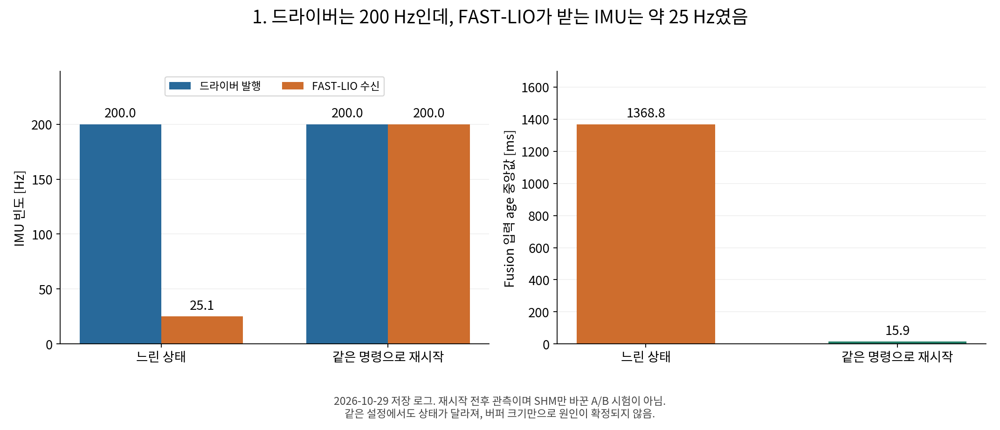
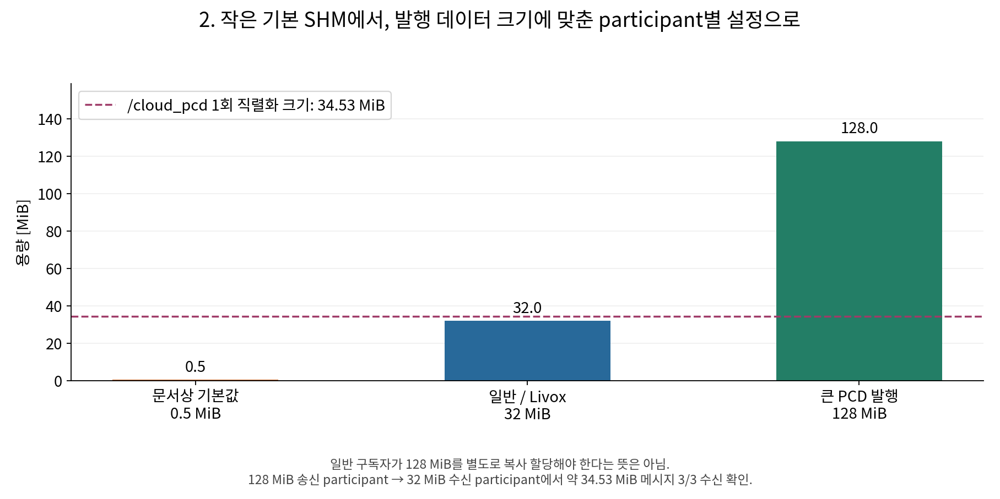
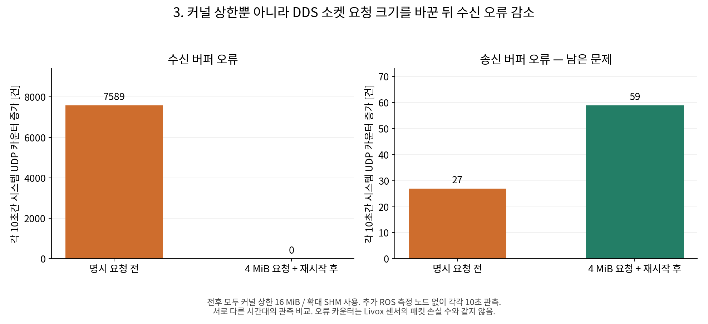
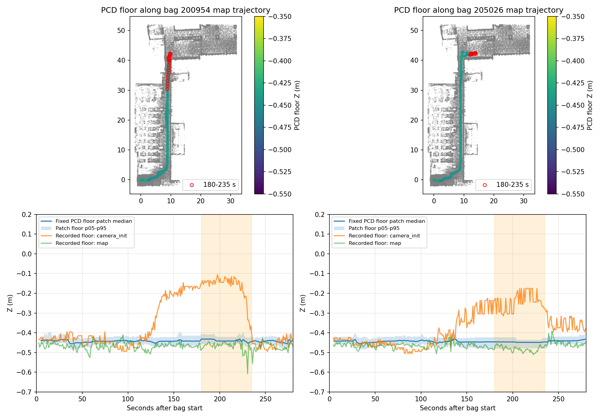
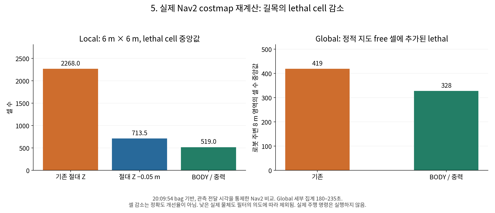

# 발표용 7장 구성 — Jetson Navigation 지연과 장애물 판정 개선

2026-11-02 · 상세 조건과 원본 근거는 [REPORT.md](REPORT.md) 참조.

## 1장. 문제가 두 종류였다

- **시간 문제:** IMU / Odometry 수신 지연과 RViz 반응 저하.
- **기하 문제:** 좁은 복도에서 바닥·낮은 물체가 local obstacle로 과도하게 표시.
- 대응도 분리: **SHM·소켓 버퍼**는 전달 경로, **BODY 높이 필터**는 obstacle 판정 경로 개선.

발표 문장: “지연 문제와 잘못된 장애물 판정을 구분해, 각각 다른 계층에서 수정했습니다.”

## 2장. IMU 발행은 정상인데 수신이 느린 상태를 포착



- 드라이버 약 200 Hz / FAST-LIO 수신 약 25 Hz.
- fusion 입력 age 중앙값 1,368.8 ms.
- 동일 명령 재시작 후 200 Hz / age 15.9 ms로 회복.

발표 문장: “드라이버 이후의 전달·처리 경로도 의심할 근거를 확보했습니다. 이 그림은 SHM 단독 A/B 결과는 아닙니다.”

## 3장. 데이터 크기에 맞게 SHM을 명시



- 일반/Livox participant: 32 MiB.
- 기존 PCD를 배포하는 송신 participant: 128 MiB.
- 약 34.53 MiB 메시지 3/3 수신과 실제 매핑 확인.
- swap, `/dev/shm` 전체 한도, participant segment는 서로 다름.

발표 문장: “큰 PCD 발행자와 일반 노드를 구분해 설정했습니다. 용량 적용은 검증했지만, 모든 지연의 원인이 SHM이라고 확정하지는 않았습니다.”

## 4장. 커널 상한만 올리는 것으로는 부족



- 커널 max: 16 MiB로 확대.
- DDS XML: 송수신 각각 4 MiB 요청.
- 프로세스 재시작 후 실제 소켓 조회값 8 MiB — Linux 관리 비용 포함.
- 10초간 수신 오류 7,589 → 0. 송신 오류 27 → 59는 남음.

발표 문장: “커널 상한과 애플리케이션 요청을 함께 맞춘 뒤 수신 버퍼 오류가 관측 구간에서 사라졌습니다. 송신 오류와 LCM 전달은 별도 문제로 남았습니다.”

## 5장. PCD보다 local 좌표계의 바닥 높이가 변함



- 조사한 복도 PCD 바닥 패치의 높이 범위: 2.19 cm / 0.33 cm.
- 같은 구간에서 `camera_init`의 바닥 Z는 크게 변함.
- 기존 absolute-Z gate 대신 **BODY 원점 + 중력 방향**으로 높이 정의.

```text
h = up_body · (sensor_point_in_body − BODY_origin_in_body)
−0.05 m ≤ h ≤ +1.0 m
```

발표 문장: “필터는 전역 높이 이동에 의존하지 않도록 바꿨습니다. 자세 추정 자체의 drift를 고친 것은 아닙니다.”

## 6장. 실제 Nav2에서 길목의 장애물 셀이 줄어듦



| Local lethal cell 중앙값 | 기존 | 절대 Z 하한 −0.05 m | BODY / 중력 |
|---|---:|---:|---:|
| 기록 기하로 Nav2 재계산 | 2,268 | 713.5 | 519 |

- 두 bag 문제 구간 바닥점 통과율: 58.81% / 28.98% → 0% / 0%.
- 몸체 높이 후보점 보존: 99.88% / 100%.
- 실제 C++ filter 계산: p50 0.493 ms / p95 0.589 ms.

발표 문장: “기록된 기하로 실제 costmap을 재계산했을 때 local의 과도한 lethal 셀이 줄었습니다. 낮은 실제 물체도 제외하므로 셀 감소를 정확도 개선율로 표현하지 않았습니다.”

보충 그림: [local 전후](figures/nav2_local_comparison.png), [global 전후](figures/nav2_global_comparison.png).

## 7장. 다음 실험에서 확인할 것

- Goal·recorder·실제 이동이 동시에 있을 때 입력 age / gap / UDP 오류.
- `/fastlio/up_body` 연속성과 filter drop / wait.
- 몸체 높이 물체 보존, 낮은 물체 처리 정책, 장애물이 지나간 뒤 clearing.
- `/cmd_vel`과 실제 LCM 송신·메인제어기 수신의 일치.

발표 문장: “현재는 설정 적용, 메시지 처리, 기록 기하 기반 costmap 효과까지 확인했습니다. 전체 실차 성공은 실시간 자세·controller·통신을 포함해 검증할 단계입니다.”

**피할 표현:** “모든 지연 해결”, “PCD/추정 drift 제거”, “장애물 정확도 77% 향상”, “LCM freeze 해결”, “전체 Navigation 실차 검증 완료”.
