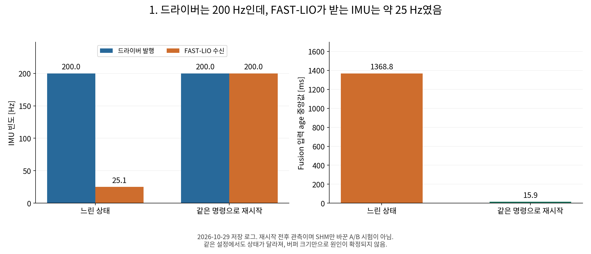
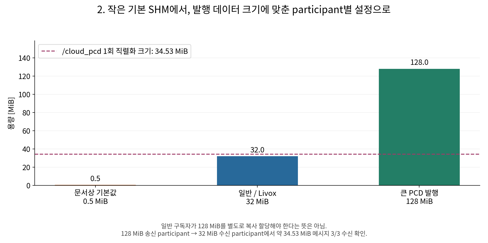
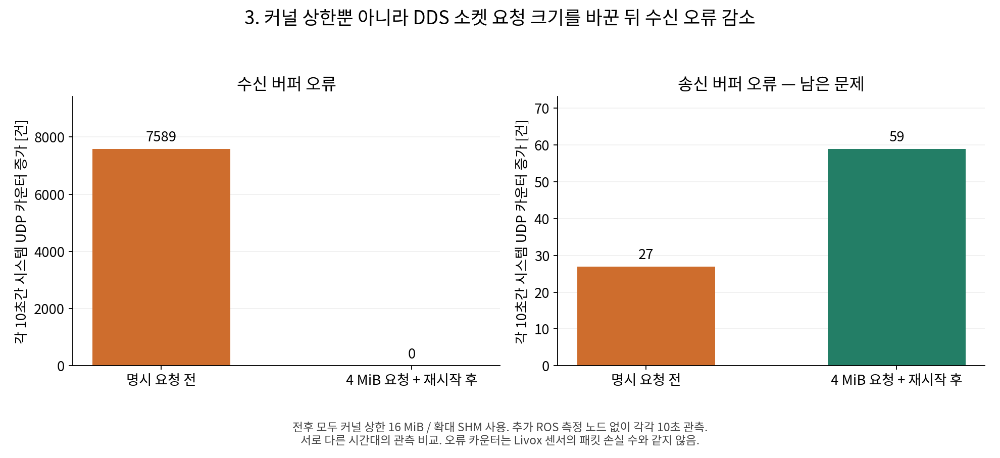
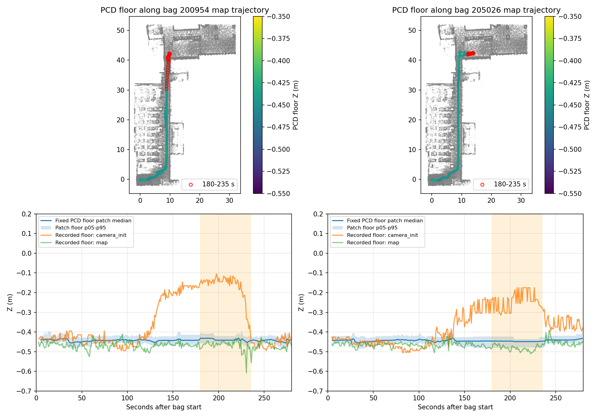
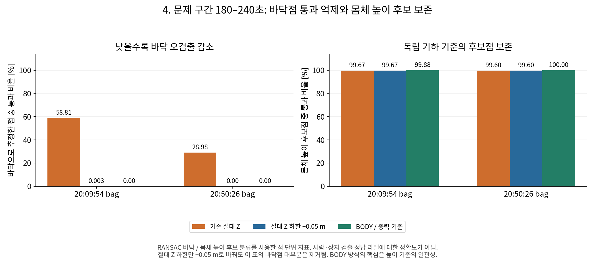
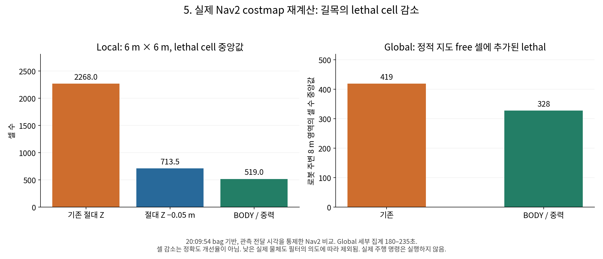
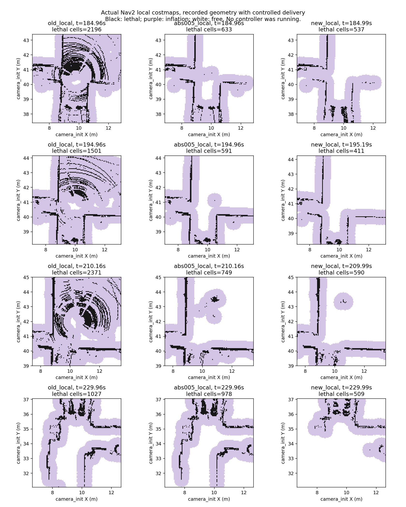
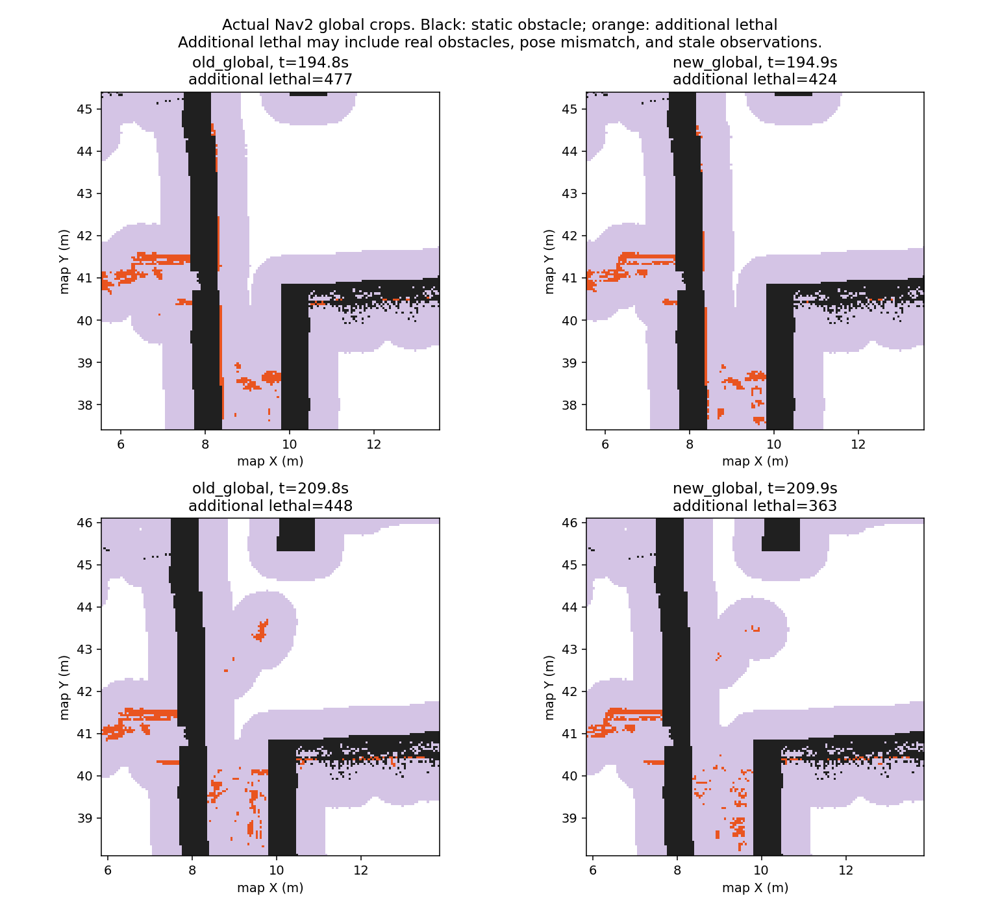

# Jetson Navigation 통신 지연 및 장애물 높이 판정 개선 보고서

작성일: 2026-11-02 · 대상: `navigation_real` / ROS 2 Humble / Fast DDS / Livox MID-360S / FAST-LIO Localization / Nav2

이 문서는 DDS 공유메모리(SHM), Linux UDP 소켓 버퍼, BODY 기준 장애물 높이 필터의 변경 이유와 검증 결과를 정리한다. **이번 보고서 작성 중에는 로봇 노드를 실행하거나 설정을 변경하지 않았다.** 기존 실험 자료를 다시 확인하고, 작은 원본 결과 파일과 코드 스냅샷을 이 폴더에 보존했다. 그림은 기존 분석 결과 또는 보존된 JSON 수치로 작성했다.

기준 브랜치: `jetson/261027-stamp-velocity` · 기준 HEAD: `ccd5fec77a304349215bdf31d2ff5015c297024d`. 보고서 기준 구현에는 HEAD 이후 작업 트리 변경도 포함된다. 실제 파일 내용과 SHA-256은 [증거 목록](evidence/manifest.json)을 기준으로 한다. 이 문서는 과거 실행의 모든 설정이 현재와 같았다고 가정하지 않는다.

## 1. 발표에서 먼저 전달할 결론

| 구분 | 이전 문제와 의심 | 적용한 변경 | 확인한 결과 | 결론의 범위 |
|---|---|---|---|---|
| DDS SHM | 드라이버 IMU 발행은 약 200 Hz인데 FAST-LIO 수신이 약 25 Hz, localization 입력 age 약 1.37초로 악화. 점군 크기 대비 작은 SHM도 의심 | 일반 participant 32 MiB, 큰 PCD 발행 participant 128 MiB, SHM + UDP 명시 | 실제 매핑 크기 확인, 약 34.53 MiB 메시지 3/3 수신 | 용량 설정·큰 데이터 전달은 검증. SHM만으로 모든 지연이 해결됐다는 인과관계는 미확정 |
| 커널 / DDS UDP 버퍼 | 커널 상한을 늘려도 DDS 소켓은 약 208 KiB 유지. 수신 버퍼 오류 증가 | 커널 상한 16 MiB + DDS TX/RX 각각 4 MiB 요청 + 프로세스 재시작 | 별도 10초 관측에서 `RcvbufErrors 7,589 → 0`. 송신 오류 `27 → 59`는 남음 | 수신 버퍼 부족 완화 근거가 강함. 전체 통신 무손실·LCM 문제 해결을 뜻하지 않음 |
| BODY / 중력 기준 높이 | local 좌표계에서 바닥 Z가 올라가며 바닥·낮은 물체가 장애물로 표시 | BODY 원점에서 중력 반대 방향 높이 −0.05~+1.0 m인 점만 Nav2에 전달 | 두 bag 문제 구간의 기하학적 바닥점 통과율 `58.81% / 28.98% → 0% / 0%`. 실제 local lethal 셀 중앙값 `2,268 → 519` | 기록된 기하와 실제 Nav2 costmap에서 효과 확인. 실시간 추정 정확도·발/다리 통과성·전체 주행 성공까지 보장하지 않음 |

발표에서는 **“통신 버퍼의 용량 부족 가능성과 실제 수신 오류를 줄이고, 장애물 판정의 높이 기준을 로봇 몸체로 바꿨다”**고 설명하는 것이 정확하다. “모든 지연의 원인을 SHM으로 확정했다”, “PCD와 FAST-LIO의 drift를 고쳤다”, “장애물 검출 정확도가 77% 좋아졌다”는 표현은 현재 자료가 뒷받침하지 않는다.

## 2. 시스템 경로와 측정값을 읽는 방법

### 2.1 서로 다른 세 경로

```text
Livox MID-360S
  └─ 센서 Ethernet UDP ─ Livox SDK 소켓 ─ livox_ros_driver2
                                           ├─ /livox/imu          : sensor_msgs/Imu
                                           ├─ /livox/lidar        : CustomMsg → FAST-LIO
                                           └─ /livox/lidar_pointcloud : PointCloud2
                                                                    ↓
                                               비대칭 거리 + BODY 높이 필터
                                                                    ↓
                                                  /livox/lidar_costmap
                                                                    ↓
                                                   local / global costmap

FAST-LIO ─ /Odometry ─ transform_fusion ─ /localization, TF
         └ /fastlio/up_body ──────────── BODY 높이 필터

Nav2 ─ /cmd_vel ─ pongbot_lcm ─ LCM Ethernet multicast ─ 메인제어기
```

Jetson 내부 ROS 2 통신에는 RMW/DDS가 쓰인다. DDS의 로컬 SHM과 UDP는 그 전송 수단이다. **Livox 센서에서 들어오는 UDP, DDS UDP, 메인제어기로 나가는 LCM은 서로 다른 소켓/프로토콜 경로**다. DDS XML 변경이 Livox 펌웨어 패킷 형식이나 LCM 명령 정책을 바꾸지는 않는다.

### 2.2 Hz, age, 계산 시간은 별개의 지표

| 지표 | 계산 / 의미 | 주의할 해석 |
|---|---|---|
| `ros2 topic hz` | 해당 구독자가 받은 메시지 간격 | 발행 루프의 직접 측정값이 아니다. DDS 손실·구독자 스케줄링·Python 변환 부하가 포함될 수 있다 |
| header age | 수신 시각 − `header.stamp` | 센서 시각, 수집 시간, 큐, 전송, 관측 노드 스케줄링의 합. 순수 DDS 지연이 아니다 |
| scan-end age | 수신 시각 − 스캔 마지막 점의 관측 시각 | scan-start stamp를 쓰는 Livox의 수집 시간과 전송 이후 지연을 구분한다 |
| `fusion input_interval` | fusion에 들어온 Odometry 콜백 간격 | 약 1,280 ms인데 fusion 연산이 0.1 ms라면 fusion 계산 자체보다 앞단을 조사해야 한다 |
| `filter_ms` | C++ 필터 계산 구간 | 자세를 기다린 시간, DDS 전송, Nav2 업데이트까지의 전체 지연과 다르다 |
| UDP 오류 카운터 | `/proc/net/snmp`의 시간 구간별 증가량 | 시스템 UDP 전체 통계다. 센서의 특정 토픽 손실 수로 환산하면 안 된다 |

예를 들어 10 Hz 스캔의 첫 점 시각을 header에 담으면, 스캔이 완성될 때 이미 약 100 ms가 지난다. 2026-10-29 정상 관측에서 `/livox/lidar` header age 중앙값은 **101.93 ms**, 같은 메시지의 scan-end age 중앙값은 **2.49 ms**였다. 이 100 ms를 모두 “통신이 밀린 시간”으로 보면 원인 분석이 틀어진다. [측정 원본](evidence/live_after_timing.json)

bag 재생 중 `Message queue starved`가 발생하거나 일시정지하면 RViz/rqt도 끊길 수 있다. 당시 수신 간격, 메시지 header 간격, 재생 속도를 분리해서 봐야 한다. `/localization`은 `/Odometry`에 지도 보정을 결합한 결과이므로, 입력 누락이 있을 때 토픽 이름만 바꿔도 해결된다고 볼 수 없다.

## 3. DDS 공유메모리(SHM)

### 3.1 이전에 나타난 현상과 확인 근거

과거 터미널에서는 `/Odometry`와 `/localization`이 약 10 Hz / 수십 ms 수준으로 동작하다가 약 0.75~0.78 Hz / 1.3초 수준으로 느려지는 현상이 반복됐다. RViz 위치 화살표도 늦게 움직였다. 다만 당시 여러 원인이 차례로 수정되었으므로, 모든 과거 지연을 하나의 SHM 문제로 합치지 않았다.

아래는 2026-10-29에 저장된 드라이버·FAST-LIO·fusion 로그를 같은 구간으로 요약한 결과다.

| 지표 | 느린 구간 | 같은 명령으로 재시작한 뒤 관측 구간 |
|---|---:|---:|
| 드라이버 IMU 발행 빈도 | 200.002 Hz | 200.005 Hz |
| FAST-LIO IMU 수신 빈도 | 25.095 Hz | 200.002 Hz |
| LiDAR/IMU 동기화 처리 빈도 | 0.750 Hz | 9.997 Hz |
| IMU mean-age 로그의 중앙값 | 1,273.909 ms | 0.437 ms |
| fusion 입력 간격 중앙값 | 1,298.3 ms | 100.7 ms |
| fusion 입력 age 중앙값 | 1,368.8 ms | 15.9 ms |
| LiDAR 대기 데이터 교체 수 | 2,286 | 0 |
| 드라이버 IMU 큐 peak의 중앙값 | 1 | 1 |

느린 구간은 epoch 1793204940~1793205190, 재시작 후 구간은 1793205655~1793205856이다. 구간 길이가 달라 교체 **개수**를 같은 시간의 비율로 취급하지 않았다. `mean-age`는 각 로그가 요약한 평균의 중앙값이다. 원시 IMU 전체 표본의 중앙값과 같다고 가정하지 않는다. [원본 요약](evidence/recurrence.json)



**해석:** 드라이버가 센서 데이터를 전혀 못 받는 상황만으로 설명하기 어렵다. 드라이버 발행 이후 DDS 전달, subscriber 처리, executor 스케줄링, 동기화 대기 등도 후보였다. 동일 명령 재시작만으로 정상화된 기록이 있으므로, “SHM 크기 변경의 단독 효과”로 이 그림을 제시하면 안 된다.

### 3.2 왜 SHM을 의심했는가

Fast DDS 2.6 문서상 기본 SHM segment는 512 KiB다. participant가 자기 송신 segment에 데이터를 두고, 수신 participant가 해당 메모리를 접근하는 구조이며 큰 데이터와 동시 전송에 맞는 여유가 필요하다. 이는 실행 파일 하나에 딱 하나씩이라는 뜻은 아니다. [Fast DDS SHM 공식 문서](https://fast-dds.docs.eprosima.com/en/2.6.x/fastdds/transport/shared_memory/shared_memory.html)

우리 드라이버의 예시 PointCloud2는 약 20,064점 × 26 byte = **521,664 byte**다. 512 KiB인 524,288 byte에 거의 근접하며, 이것도 직렬화 부가 정보 전 크기다. 같은 드라이버에서 CustomMsg·PointCloud2·IMU가 함께 발행되고 있어 충분한 여유가 없을 수 있다고 판단했다. 단, 이 계산만으로 내부 큐 포화나 IMU 손실이 실제 발생했다고 증명한 것은 아니다.

추가로 localization launch의 `pcd_to_pointcloud`가 기존 PCD를 읽어 `/cloud_pcd`를 발행한다. **새 SLAM 지도를 만드는 것이 아니라, 보유 지도를 ROS 점군으로 배포하는 역할**이다. 01:50:03 bag에서 이 토픽은 직렬화 크기 약 **34.53 MiB/회**, 약 3초마다 98회 기록되어 총 payload가 약 3.55 GB였다. 따라서 “localization만 하니 큰 점군은 없다”는 가정은 맞지 않았다.

해당 bag에서 PCD header 주변 ±150 ms 표본의 IMU age p95는 17.765 ms, 나머지는 1.153 ms였다. 이는 큰 점군 전송/복사/기록 부하와 시간상 겹치는 **상관관계**다. SHM 포화, CPU 복사, recorder 부하 중 어느 하나를 단독 원인으로 특정하지 않는다. [bag 측정 원본](evidence/baseline_bag_timing.json), [기존 상세 분석](../../DDS_SHM_VALIDATION.md)

### 3.3 어떻게 바꿨는가

| 대상 | 초기 / 중간 상태 | 현재 명시 설정 | 적용 방식 |
|---|---|---|---|
| Livox DDS participant | 작은 기본값 의심 → 드라이버 전용 16 MiB 적용 단계 | **32 MiB** | `dds_profile:=livox` |
| FAST-LIO, fusion, 일반 Nav2 등 | 프로세스별 기존/상속 설정 | **32 MiB** | `dds_profile:=navigation`의 common 그룹 |
| localization의 큰 PCD 발행 프로세스 | 큰 `/cloud_pcd` 메시지 배포 | **128 MiB** | launch 내부 large 그룹으로 분리 |
| 별도 recorder / RViz | 별도 터미널은 설정 상속 여부 확인 필요 | common **32 MiB** | `ros2 run navigation_dds with_profile common ...` |
| 큰 PCD를 재발행하는 bag player | 재생 과정에서 큰 데이터 발행 | large **128 MiB** | `ros2 run navigation_dds with_profile large ...` |

“FAST-LIO localization 전체를 무조건 128 MiB로 만든다”가 아니라 **큰 PCD 송신자만 128 MiB, 일반 노드는 32 MiB**로 구분했다. 16 MiB는 이전 중간 단계이며 현재 파일의 driver segment는 32 MiB다.

```xml
<!-- 일반 / Livox -->
<type>SHM</type>
<segment_size>33554432</segment_size>

<!-- 큰 PCD 송신 participant -->
<type>SHM</type>
<segment_size>134217728</segment_size>
```

SHM과 UDPv4 transport를 함께 명시하고 `useBuiltinTransports=false`로 지정했다. launch helper는 `FASTRTPS_DEFAULT_PROFILES_FILE`과 `FASTDDS_DEFAULT_PROFILES_FILE`을 자식 프로세스에 적용한다. ROS endpoint의 QoS/history나 센서 timestamp를 이 설정에서 바꾸지 않는다. UDP 크기 설정은 다음 절의 별도 변경이다.

관련 코드: [common XML](evidence/current_source/navigation_dds/config/fastdds_common.xml), [large XML](evidence/current_source/navigation_dds/config/fastdds_large.xml), [Livox XML](evidence/current_source/livox_ros_driver2/config/fastdds_livox_shm.xml), [launch helper](evidence/current_source/navigation_dds/navigation_dds/profiles.py).

### 3.4 적용 후 무엇을 검증했는가

격리된 ROS domain 214에서 실제 SHM 매핑과 큰 메시지 수신을 확인했다.

| 확인 항목 | 관측 결과 |
|---|---|
| 송신 payload | 36,209,289 byte ≈ 34.53 MiB |
| 송신 설정 | 128 MiB |
| 송신 프로세스 매핑 크기 | 134,246,400 byte — 관리 영역 포함 |
| 수신 participant 자체 설정 | 32 MiB |
| 수신 자체 매핑 크기 | 33,583,104 byte — 관리 영역 포함 |
| 실제 수신 | sequence 1, 2, 3 모두 수신 |
| 송신 publish 호출 시간 | 약 22.8~29.6 ms; 수신 완료 지연과 같지는 않음 |



수신자는 원격 송신 segment도 매핑했다. “32 MiB subscriber는 34.53 MiB 데이터를 절대 받을 수 없다”는 단순한 버퍼 복사 모델과 다르다. [송신 결과](evidence/shm_send.json), [수신 결과](evidence/shm_receive.json)

**이 시험으로 확인한 것:** XML 적용, 실제 segment 크기, 큰 payload 전달 가능성. **확인하지 않은 것:** 전체 navigation의 최악 부하, 모든 토픽 무손실, SHM 확대만의 지연 개선율.

### 3.5 메모리 용어와 남은 문제

| 항목 | 의미 |
|---|---|
| 물리 RAM | Jetson 프로세스와 커널 등이 함께 사용하는 메모리 |
| `/dev/shm` | 공유메모리에 사용하는 tmpfs 공간. 표시 용량은 별도의 추가 RAM이 아님 |
| DDS SHM segment | participant가 사용하는 공유메모리 영역의 크기 |
| swap | 메모리 압박 시 쓰는 별도 메커니즘. DDS segment 크기와 다름 |
| UDP socket buffer | 커널이 UDP 송수신을 위해 사용하는 버퍼. DDS SHM과 별도 |

participant가 늘면 segment 예약/매핑과 DDS history, 점군 복사 버퍼도 함께 늘어난다. 예를 들어 common 19개와 large 1개라면 설정 크기 합은 736 MiB다. 이 합을 실제 물리 RAM 점유량과 동일시하지는 않지만, 프로세스 수까지 포함해 예산을 잡아야 한다.

32/128 MiB는 실측 데이터 크기에 근거한 시작값이다. 더 키우는 것으로 계산 과부하, QoS 불일치, 센서/IMU 누락, LCM 케이블 단절, 오래된 명령 재전송까지 해결되지는 않는다.

## 4. Linux 커널 소켓 상한과 DDS UDP 버퍼

### 4.1 이전 문제: 상한을 올려도 소켓은 작았다

초기 커널 값은 `rmem_max=wmem_max=212992` byte, 즉 약 208 KiB였다. 이후 16 MiB로 상한을 올렸지만, explicit 요청이 없던 DDS UDP 소켓은 계속 작은 기본 크기를 사용했다. 그 상태에서도 수신 버퍼 오류가 증가했다.

```bash
# 확인 명령 — max와 default를 함께 확인
sysctl net.core.rmem_max net.core.wmem_max \
       net.core.rmem_default net.core.wmem_default
ss -uapnm
cat /proc/net/snmp
```

`ss -m`의 `rb`, `tb`, `d` 등은 소켓 버퍼 한도·drop을 확인하는 단서다. 다른 사용자 프로세스의 소켓 정보는 권한에 따라 보이지 않을 수 있다. `/proc/net/snmp`는 누적값이므로 일정 간격을 두고 **차이**를 계산해야 한다.

### 4.2 원리: 커널 상한, 앱 요청, 생성 시점을 모두 맞춰야 한다

```text
net.core.rmem_max / wmem_max  : 앱이 일반 setsockopt로 요청할 수 있는 상한
                 ↓
DDS receiveBufferSize / sendBufferSize : 해당 앱의 실제 요청
                 ↓
소켓 생성 / 설정 : 새 프로세스의 소켓에 반영
```

`max`만 올린다고 이미 열린 모든 소켓이나 default 값이 자동으로 커지는 것은 아니다. Linux는 SO_RCVBUF/SO_SNDBUF를 조회할 때 관리 비용을 포함한 두 배 값을 반환할 수 있다. [Linux socket(7)](https://www.man7.org/linux/man-pages/man7/socket.7.html)

DDS XML의 buffer size를 지정하지 않으면 시스템 기본값에 의존한다. [Fast DDS UDP transport XML](https://fast-dds.docs.eprosima.com/en/2.6.x/fastdds/xml_configuration/transports.html)

### 4.3 적용한 두 단계

**1단계 — 실행 시 커널 상한 확대**

```bash
sudo sysctl -w net.core.rmem_max=16777216 net.core.wmem_max=16777216
```

이는 “제한 해제”가 아니라 **상한을 16 MiB로 확대**한 것이다. 당시 `rmem_default/wmem_default`는 212,992 byte로 유지했다. `/etc/sysctl.conf` 등에 영구 저장하는 작업은 이 변경에 포함하지 않았다. 따라서 재부팅 후에는 값을 확인하고 필요하면 다시 적용한다. [적용 전](evidence/kernel_before.json), [적용 후](evidence/kernel_after.json)

**2단계 — DDS XML에서 송수신 각각 4 MiB 요청, 해당 프로세스 재시작**

```xml
<transport_descriptor>
  <transport_id>rubi_udp</transport_id>
  <type>UDPv4</type>
  <sendBufferSize>4194304</sendBufferSize>
  <receiveBufferSize>4194304</receiveBufferSize>
</transport_descriptor>
```

`common`, `large`, `livox` 세 프로파일 모두 반영했다. 격리 domain 215에서 세 프로파일의 실제 소켓을 확인했고, 당시 변경 관련 빌드는 2개 패키지 통과, 기존 pytest는 9개 통과였다. 이는 **당시 검증 기록**이며, 보고서 작성 중 다시 실행한 빌드 결과가 아니다. [검증 결과](evidence/udp_socket_validation.json)

| 설정 / 관측 | 변경 전 | 변경 후 |
|---|---:|---:|
| 커널 max | 212,992 byte | 16,777,216 byte |
| 커널 default | 212,992 byte | 그대로 유지 |
| DDS 명시 요청 | 없음 / 기본 의존 | TX, RX 각 4,194,304 byte |
| 변경 전 DDS 소켓 관측 | 약 212,992 byte | 해당 없음 |
| 새 DDS 소켓 조회값 | 해당 없음 | TX, RX 각 8,388,608 byte — Linux 회계상 두 배 |

**Livox SDK 소켓과의 차이:** 로컬 SDK `CreateSocket()`은 원래 수신 버퍼 200 MiB를 요청한다. 16 MiB cap에서 센서 포트 소켓의 조회값 33,554,432 byte가 관측됐다. DDS의 4 MiB 요청과는 별도다. 이번 DDS XML 수정은 센서 패킷 포맷 변경이 아니다. [당시 소켓 조사 내용](evidence/live_before_report.md)

### 4.4 Before / After: 수신 오류 감소, 송신 오류는 남음

비교 전 시점에도 이미 SHM과 커널 max는 확대되어 있었다. 여기서 달라진 핵심은 **DDS 앱의 실제 소켓 요청과 재시작**이다.

| 각 10초 passive 관측 | 명시 DDS 요청 전 | 4 MiB 요청 적용·재시작 후 |
|---|---:|---:|
| `RcvbufErrors` 증가 | 7,589 | **0** |
| `SndbufErrors` 증가 | 27 | **59** |
| `InDatagrams` 증가 | 114,947 | 124,753 |
| `OutDatagrams` 증가 | 95,684 | 94,665 |
| 소켓별 drop 증가 | 여러 DDS 포트에서 관측 | 관측 목록 없음 |



두 구간 모두 추가 ROS 측정 subscriber 없이 확인했다. 그러나 서로 다른 시간의 실행이며 재시작도 포함한다. 무작위·반복 A/B 시험은 아니다. 전후 수신 트래픽 규모가 비슷한 상황에서 수신 버퍼 오류가 없어졌다는 점은 유의미하다. 동시에 송신 오류가 남았으므로 “UDP 문제가 전부 해결됐다”고 쓰지는 않는다. [전](evidence/udp_before_passive.json), [후](evidence/udp_after_passive.json)

변경 전 drop이 관측된 10664~10700 등은 조사 당시 DDS discovery/metatraffic 경로와 연결됐다. `RcvbufErrors=7589`를 그대로 “Livox IMU 7589개 유실”이라고 해석해서는 안 된다.

### 4.5 토픽 지연 전후: 평균적 개선과 최댓값을 함께 공개

Livox·Localization·Nav2를 실행하고 **Goal을 주지 않은** 상태의 관측이다. 전은 초기 관측기 준비 2초를 제외한 약 58초, 후는 관측기 준비 후 60초다. raw sensor → filter 구성은 당시 코드이며, 11월 2일 BODY 필터까지 함께 시험한 결과가 아니다.

| 토픽 / 지표 | 변경 전 p50 / p95 / max [ms] | 변경 후 p50 / p95 / max [ms] |
|---|---:|---:|
| `/livox/imu` header age | 0.576 / 1.839 / 29.630 | 0.588 / 2.050 / 36.575 |
| `/livox/lidar` scan-end age | 2.533 / 4.885 / 24.760 | 2.486 / 5.276 / 28.137 |
| `/Odometry` header age | 17.408 / 22.417 / 26.489 | 13.535 / 20.146 / 42.915 |
| `/localization` header age | 17.818 / 22.349 / 27.541 | 14.277 / 20.458 / 43.146 |
| `/livox/lidar_costmap` header age | 106.063 / 110.165 / 118.807 | 105.130 / 108.756 / 123.579 |

두 구간 모두 IMU 약 200 Hz, CustomMsg·Odometry·localization 약 10 Hz, PointCloud2·필터 출력 약 5 Hz였다. Odometry/localization 중앙값은 줄었지만 max는 오히려 커졌다. 이 결과는 “모든 latency percentile이 개선됐다”는 주장과 다르다. [전 측정](evidence/live_before_timing.json), [후 측정](evidence/live_after_timing.json)

당시 local costmap 메시지 관측 빈도는 약 3.3 Hz였다. 설정값 5 Hz, 내부 update 빈도, RViz로 발행되는 grid 빈도는 구분해야 한다. 이 기록만으로 local costmap이 항상 5 Hz 발행한다고 단정하지 않는다.

후 관측의 기존 LCM 프로세스는 재시작 전 것이어서 작은 DDS 소켓 설정이 남아 있었다. “XML 파일을 저장했으니 모든 실행 중 노드가 즉시 바뀐다”는 가정이 틀리다는 실제 사례다. [후 관측 상세](evidence/live_after_report.md)

## 5. BODY 원점·중력 방향 장애물 높이 필터

### 5.1 이전 문제와 bag 근거

사용자는 좁은 복도 진입 후 평평한 길목에 장애물이 갑자기 많이 잡히고, local costmap이 길을 막는 모습을 관찰했다. `/Odometry`의 높이는 증가하는 반면 지도 보정 후 `/localization` 높이는 상대적으로 덜 변했다.

기존 obstacle layer는 입력 점을 costmap global frame으로 변환한 뒤 절대 Z 범위로 판단했다. local은 `camera_init`, global은 `map`이었다. 따라서 같은 물리적 바닥도 local/world 좌표계 Z가 변하면 통과 여부가 달라질 수 있었다. raw `BODY.z`만 쓰는 것도 몸체가 pitch/roll로 기울면 중력 방향 높이와 다르다.

| 분석 bag | 기존 local 높이 범위 | 기존 global 높이 범위 | 주 분석 구간 |
|---|---|---|---|
| `rosbag2_2026_10_30-20_09_54` | camera_init Z −0.15~+1.0 m | map Z −0.20~+2.0 m | 시작 후 180~240초 |
| `rosbag2_2026_10_30-20_50_26` | camera_init Z −0.20~+1.0 m | map Z −0.20~+2.0 m | 시작 후 180~240초 |

과거 설정은 bag별로 달랐다. 현재 YAML의 −0.05 m와 과거 기준을 섞어서 비교하지 않았다.

### 5.2 PCD 지도가 먼저 40 cm 휘었는가

기존 PCD의 해당 복도 바닥을 별도로 조사했다. 기록된 map 좌표는 PCD의 XY 위치를 고르는 데 쓰고, 반경 0.65 m의 바닥 높이 군집을 추출했다. 2 cm histogram, 최빈 높이 주변 ±4 cm, 최소 30점, 1초 간격 표본을 사용했다.

| PCD의 180~235초 대응 구간 | 20:09:54 경로 부근 | 20:50:26 경로 부근 |
|---|---:|---:|
| 바닥 패치 중앙값의 최대−최소 | **2.19 cm** | **0.33 cm** |
| 해당 패치 평면 적합 경사 | 1.33° | 0.12° |
| 평면 적합 잔차 p95 | 5.26 mm | 0.70 mm |



그림의 주황색은 기록된 `camera_init`에서의 바닥, 초록색은 기록된 `map`에서의 바닥, 파란색은 고정 PCD 바닥 패치의 높이이다. 문제 구간에서 local 바닥 Z 변화가 고정 PCD보다 크다. **조사한 복도 PCD에서 약 40 cm의 바닥 단계가 발견되지는 않았다.** 다만 중첩 패치는 독립 표본이 아니고 측량 정답도 없으므로, PCD 전체의 global deformation이 0이라는 뜻은 아니다. [PCD 분석 원본](evidence/pcd_floor_summary.json)

이 결과는 절대 Z 판정이 취약하다는 근거다. 왜 FAST-LIO의 특정 자세·높이가 변했는지, IMU 기록 누락과 얼마만큼 관련되는지는 별도의 추정기 검증 주제다.

### 5.3 해결 목적: 바닥 찾기가 아니라 몸체 높이 띠 선택

목표는 **몸체와 부딪힐 높이의 점을 obstacle layer에 전달하는 것**이다. 지면을 매 순간 완벽히 추정하거나, 다리로 넘을 수 있는 물체를 분류하는 알고리즘이 아니다.

몸체 원점을 기준으로 중력 반대 방향을 +높이로 삼고 다음 범위를 통과시킨다.

```text
min_body_height = −0.05 m
max_body_height = +1.00 m

−0.05 <= 몸체 원점에서 중력 반대 방향으로 잰 높이 <= 1.00
```

이 값은 “지면에서 5 cm 이상”이 아니다. **BODY보다 5 cm 낮은 수평면부터 BODY보다 1 m 높은 수평면까지**라는 뜻이다. 로봇이 쪼그리거나 몸체 높이가 달라지면 판정 띠도 함께 움직인다. 이 범위는 사용자와 합의한 실험값이며 실제 몸체 충돌 외형의 완전한 모델은 아니다.

### 5.4 구현 수식과 좌표계

FAST-LIO 내부 추정 상태에서 중력 반대 방향을 읽어 출력한다.

```text
R = FAST-LIO body(IMU) → camera_init 회전
g = camera_init에서 추정된 중력 벡터
u_body = Rᵀ × (−g / |g|)

/fastlio/up_body:
  type     = geometry_msgs/Vector3Stamped
  frame_id = body       # 소문자: FAST-LIO IMU 좌표계
  stamp    = /Odometry와 같은 scan-end 시각
```

순간적인 raw IMU 가속도를 그대로 중력으로 간주하지 않는다. 필터는 점군 관측 시각에 맞는 up 벡터를 받아, 센서 점과 로봇 중심을 같은 소문자 body 좌표로 표현한 뒤 높이를 계산한다.

```text
p_L                    : livox_frame 점
R_body_L, t_body_L      : body에서 표현한 센서 외부 변환
t_body_BODY            : body에서 표현한 대문자 BODY 원점

p_relative = R_body_L × p_L + t_body_L − t_body_BODY
h = u_body · p_relative
keep = (−0.05 <= h <= +1.0)
```

실제 점 루프에서는 평면의 normal과 offset을 한 번 계산하고 `h = nx*x + ny*y + nz*z + offset`으로 평가한다. 매 점 TF 조회나 새로운 지면 RANSAC을 수행하지 않는다. 단위 시간 비용은 대체로 입력 점 수에 비례한다.

**전역 Z drift에 덜 민감한 이유:** 점과 BODY 원점에 공통으로 붙는 전역 translation은 차이를 취하면 사라진다. map의 절대 Z를 높이 판정 식에 넣지 않는다. 다만 `u_body`나 외부 변환이 잘못되면 높이는 여전히 잘못된다. XY 위치·yaw·점군 정합의 오류도 이 필터가 고치지 않는다.

| 프레임 | 역할 / 현재 관계 |
|---|---|
| `body` | FAST-LIO IMU 기준, 소문자 |
| `BODY` | 로봇 몸체 중심, 대문자 |
| `base_link` | 현재 BODY와 일치하도록 연결 |
| `livox_frame` | 드라이버 축 반전이 이미 적용된 점군 프레임 |

현재 BODY/base_link → Livox translation은 `(0.0995, 0, −0.1375) m`이다. 드라이버에서 LiDAR/IMU에 축 반전을 적용하므로 필터에서 x축 180° 회전을 또 적용하지 않는다. 관련 TF 스냅샷은 [localization launch](evidence/current_source/FAST_LIO_LOCALIZATION2/launch/localization.launch.py)에 있다.

### 5.5 점군 관측 시각을 유지하고, 없는 자세는 만들어내지 않음

| 설정 / 동작 | 현재 값과 의미 |
|---|---|
| 입력 → 출력 | `/livox/lidar_pointcloud` → `/livox/lidar_costmap` |
| 방향 입력 | `/fastlio/up_body`, frame `body` |
| 높이 원점 | `BODY` |
| up 보간 구간 최대 길이 | `max_up_gap_s: 0.25` |
| 방향/TF 대기 최대 | `max_wait_s: 0.25` |
| 점군 최대 age | `max_cloud_age_s: 0.5` |
| 대기 점군 큐 | 최대 4개 |
| up 이력 | 최대 64개 |
| 미래 시각 허용 오차 | 0.05초 |
| 방향이 없거나 오래됨 | 해당 점군을 버리고 진단 로그. 원본 점군으로 우회하지 않음 |
| clock 역행 | 이력·대기 큐 초기화 |
| 출력 점 | 남긴 원래 point record bytes 유지; header/stamp/fields 유지 |

정확히 같은 시각의 up 또는 앞뒤 시각의 보간을 사용한다. 최신 자세를 오래된 점군에 무조건 적용하거나, 시간 구간 밖으로 extrapolate하지 않는다. 이 과정이 입력 부실을 보이게 할 수는 있다. 하지만 timestamp를 0 또는 now로 덮어써서 결측을 숨기지는 않는다.

현재 PointCloud2 한 메시지에는 스캔 동안의 점들이 포함된다. 이 변경은 메시지 관측 시각에 맞춘 높이 판정이며 **각 점별 새로운 deskew 구현은 아니다.** 빠른 pitch/roll 중 스캔 내부 변화는 추가 검증 대상이다.

### 5.6 비대칭 거리 필터와 Nav2 연결

기존 비대칭 거리 조건과 새 높이 조건을 모두 통과한 점만 출력한다.

```yaml
costmap_sector_filter:
  ros__parameters:
    front_half_angle_deg: 60.0
    front_min_range: 0.3
    other_min_range: 1.0
    min_body_height: -0.05
    max_body_height: 1.0
    up_topic: /fastlio/up_body
    up_frame: body
    height_origin_frame: BODY
```

거리와 각도는 **센서 XY 원점 / 전방 +X 기준**이다. BODY 중심 거리와 완전히 같지는 않다. 전방 ±60°는 0.3 m 미만을 제외하고, 나머지는 1.0 m 미만을 제외한다. 이 두 값은 최대 감지 거리도, Livox 하드웨어 사양도 아니다.

local/global obstacle layer는 둘 다 `/livox/lidar_costmap`을 받는다. layer 및 observation source의 기존 절대 높이 제한은 `−10000~+10000 m`로 넓혀 **BODY 필터 후 다시 camera_init/map 절대 Z로 잘리는 이중 필터를 피했다.** 이 값 자체가 장애물 허용 높이를 20 km로 운영한다는 뜻은 아니며, 앞단 BODY 높이 필터가 반드시 연결되어야 한다.

Global layer 순서는 `static → obstacle → inflation`이다. 필터는 live obstacle 입력에 적용되므로 **기존 static map에 그려진 벽/장애물을 지우지는 않는다.** local/global XY 프레임도 그대로 유지한다.

코드: [FAST-LIO 방향 발행](evidence/current_source/FAST_LIO_LOCALIZATION2/src/laserMapping.cpp), [높이 수식/시간 버퍼](evidence/current_source/pongbot_navigation/include/pongbot_navigation/height_filter.hpp), [필터 노드](evidence/current_source/pongbot_navigation/src/costmap_sector_filter.cpp), [현재 YAML](evidence/current_source/pongbot_navigation/config/nav2_rubi_dwb.yaml).

### 5.7 Before / After ①: 같은 bag 점에 대한 기하학적 비교

두 bag에서 총 **799 frame / 7,099,765점**을 분석했다. 시간 bracket이 충분하지 않은 표본 22개/31개는 제외했다. 분석 입력은 당시 기록된 `/livox/lidar_costmap`의 센서 좌표 점으로, 이미 당시 거리 필터를 거친 점들이다. 따라서 raw 전체 LiDAR에 대한 성능으로 확대 해석하지 않는다.

바닥점은 별도 RANSAC 평면 주변 ±3 cm, 몸체 높이 후보는 독립적으로 구한 바닥 법선을 이용한 BODY 상대 +0.05~+0.8 m 점으로 분류했다. 이는 사람/상자 등 의미적 정답 라벨이 아니다.

| 문제 구간 180~240초 | 기존 local | 절대 Z 하한만 −0.05로 조정 | 새 BODY / 중력 기준 |
|---|---:|---:|---:|
| 20:09:54 바닥점 통과 | 58.8075% | 0.0030% — 333,556점 중 10점 | **0%** |
| 20:50:26 바닥점 통과 | 28.9769% | 0% | **0%** |
| 20:09:54 몸체 높이 후보 보존 | 99.6749% | 99.6749% | **99.8787%** |
| 20:50:26 몸체 높이 후보 보존 | 99.5976% | 99.5976% | **100%** |



**대조군 해석:** 이 구간에서는 기존 절대 Z 하한을 −0.05 m로 올리는 것만으로도 바닥점 대부분이 사라졌다. BODY 방식의 장점은 한 bag의 특정 drift 크기에 맞춘 절대값에 의존하지 않고 몸체 기준의 의미를 유지하는 것이다. 장시간/다른 자세에서 우월한지는 별도 실험으로 확인해야 한다.

기존 global 기준에서는 두 bag 모두 이 분석의 바닥점 통과율이 0%였다. 그러므로 global에 보이던 장애물을 모두 “바닥 오검출”이라고 할 수 없다. 낮은 실제 물체, 기존 static map, inflation, clearing 이력 등도 구분해야 한다.

방향 데이터도 재구성했다. 첫 bag은 초반 안정 IMU와 기록된 자세를, 두 번째는 당시 중력 로그와 기록된 자세를 사용했다. 새 `/fastlio/up_body`가 과거 bag에 그대로 기록되어 있던 것은 아니다. [전체 수치와 민감도](evidence/height_geometry_summary.json)

### 5.8 Before / After ②: 실제 C++ 필터로 원본 메시지 검증

실제 ROS C++ 필터 노드에 원본 PointCloud2와 재구성 방향을 넣어 결과를 비교했다.

| 검증 항목 | 결과 |
|---|---|
| 원본과 매칭하여 확인한 점군 | 91개 |
| 확인한 원본 점 | 1,818,432개 |
| 남긴 point record | 원본과 byte 단위 동일 |
| header / stamp / fields | 유지 확인 |
| 오래된 방향 | 거부 확인 |
| 새 정상 방향 | 출력 복구 확인 |
| 필터 계산 시간, 39회 로그 | p50 **0.493 ms**, p95 **0.589 ms**, max **0.615 ms** |

관측 측 매칭 누락 1개가 있어 모든 관측 메시지의 완전한 일치 검증이라고 하지는 않는다. 방향을 원본 cloud 시각에 맞춰 공급했으므로, 실시간 DDS 순서나 IMU/FAST-LIO 추정 성능 시험은 아니다. 계산 비용이 작은지와 메시지 처리의 정확성을 확인한 단계다. [결과](evidence/height_actual_node_summary.json), [C++ 로그](evidence/height_actual_node.log)

### 5.9 Before / After ③: 실제 Nav2 costmap 비교

20:09:54 bag의 170~240초 원본 PointCloud2 **344개**와 기록된 자세를 사용해 구/신 costmap을 다시 계산했다. up/TF는 10 Hz로 공급하고 점군은 header+120 ms에 전달해 원래 recorder 통신 지연을 분리했다. 필터 입력/출력은 344/344개였다.

단순 점 산포도가 아니라 **실제 Nav2 obstacle / inflation layer의 결과**다. 이 시험에서는 controller, LCM, 모터 명령, 실시간 추정기를 실행하지 않았다. 구/신 조건의 높이·입력 경로 외에 신 조건은 observation freshness 설정도 다르지만, 비교에서는 새로운 입력을 계속 공급했다.

| 지표 | 기존 절대 Z | 절대 Z 하한 −0.05 m | BODY / 중력 기준 |
|---|---:|---:|---:|
| local 6×6 m lethal 셀 중앙값 | **2,268** | **713.5** | **519** |
| local lethal 셀 p95 | 3,028.8 | 925.85 | 623.1 |
| global 로봇 주변 8 m 영역 전체 lethal 중앙값 | 4,212 | 별도 집계 없음 | 4,151 |
| global static-free에 추가된 lethal 중앙값 | **419** | 별도 집계 없음 | **328** |

local lethal 중앙값은 기존 대비 약 **77.1% 감소**, 절대 Z −0.05 대조군 대비 약 **27.3% 감소**했다. global static-free 추가 장애물 셀은 약 **21.7% 감소**했다. global 세부 추가 셀 통계는 180~235초의 이동 영역을 사용한다. **셀 감소율을 장애물 검출 정확도 개선율로 부르면 안 된다.**



아래 그림은 기존 local / 절대 Z −0.05 / BODY 방식 순서다. 검정은 lethal, 보라는 inflation, 흰색은 free다. 기존 방식의 길목 안쪽 곡선 띠 형태 장애물이 줄어들고 벽과 구조물 주변 장애물이 남는다. 각 그림은 가까운 publish 시각을 선택했으므로 캡션의 시각이 완전히 같지는 않다.



Global에서는 검정 static map을 그대로 두고, static-free에 추가된 주황색 lethal 셀을 비교한다. local처럼 큰 차이를 기대하기보다, 어느 부분이 static이고 어느 부분이 live obstacle인지 분리해야 한다.



이 재생 시험의 grid 발행은 local 약 3 Hz, global 약 0.62 Hz로 관측됐다. 구/신 공통으로 discrete simulated clock과 publish due 조건이 영향을 주었으며, 설정한 5/1 Hz의 시각화 발행이나 내부 갱신 주기를 모두 입증한 시험은 아니다. [costmap 집계 및 조건](evidence/height_costmap_summary.json)

### 5.10 Clearing은 어떻게 바뀌는가

Nav2는 관측한 실제 endpoint까지 raytracing하여 해당 obstacle layer의 자유 공간을 갱신한다. 이번에는 **높이·거리 조건을 통과해 남은 실제 점만 marking과 clearing에 모두 사용**한다. 제거한 바닥점 대신 가상의 먼 점을 만들거나, 원본 바닥점 전체를 별도의 clearing 입력으로 보내지 않았다.

이 선택은 허위 clearing ray를 만드는 일을 피하지만, 남은 ray가 줄어 기존 장애물의 제거가 느려질 수 있다. 두 bag 문제 구간의 5° 방향 bin 기준 ray 범위 중앙값은 68→34, 52→28로 감소했다. 이는 Nav2 clearing 성공률 자체는 아니지만, clearing 관측이 줄었다는 단서다.

`observation_persistence: 0.0`은 오래된 obstacle 셀이 자동으로 사라지는 TTL이 아니다. `expected_update_rate: 0.5`의 단위는 Hz가 아니라 **초**이며 관측 freshness 조건이다. 이 값이 있다고 낡은 셀을 자동 삭제하거나 무조건 멈추는 별도 watchdog을 구현한 것은 아니다.

### 5.11 남은 약점과 실험에서 확인할 점

1. **중력 방향이 틀리면 높이도 틀린다.** 4 m 거리에서 3° 방향 오차는 약 0.21 m 높이 오차를 만들 수 있다. 별도 민감도 시험에서 3° 교란만으로 일부 프레임의 몸체 높이 후보 보존율이 26.3% / 43.7%까지 낮아졌다. 평균 보존율만으로 자세 오차에 강하다고 주장하면 안 된다.
2. **낮은 실제 물체도 제거한다.** 작은 상자/발 부근 물체를 height map 등에서 처리한다는 시스템 목적과 맞아야 한다. 현재 `navigation_real`의 2D Nav2 실행만으로 별도의 height-map traversability가 자동 연결되는 것은 아니다.
3. **자세 방향이 끊기면 필터도 점군을 버린다.** `cloud_drops`, `up_drops`, `wait_ms`를 함께 봐야 한다. raw bag으로 FAST-LIO를 다시 돌린 짧은 시험은 up/Odometry 71회, filter 출력 32회였으며, 지속적인 전체 파이프라인 성공으로 볼 수 없다. [짧은 인터페이스 시험](evidence/height_smoke_summary.json)
4. **PCD 정합, XY/yaw drift는 그대로 남을 수 있다.** 장애물 판정의 Z 기준을 개선한 것이지 localization 알고리즘을 대체한 것이 아니다.
5. **clearing 지연과 static obstacle은 별도다.** 사라진 물체 자리의 잔상, 장애물 뒤 가려진 공간, 회전 후 전방에 들어오는 물체를 확인해야 한다.

높이 필터를 위해 FAST-LIO 추정 상태에서 방향 출력을 추가했으나, 이 변경 자체가 상태 보정 수식을 새로 적용한 것은 아니다. 다만 앞선 작업에는 `extrinsic_est_en`의 실제 반영 수정 등 추정기 관련 변경도 있었으므로, 전체 작업 이력을 통틀어 “실시간 자세 추정 코드는 전혀 건드리지 않았다”고 쓰지는 않는다.

## 6. 설정 위치, 적용 및 재현 절차

### 6.1 인수인계 시 확인할 파일

| 파일 | 역할 |
|---|---|
| `navigation_dds/config/fastdds_common.xml` | 일반 DDS SHM 32 MiB / UDP TX·RX 4 MiB |
| `navigation_dds/config/fastdds_large.xml` | 큰 PCD 송신 SHM 128 MiB / UDP TX·RX 4 MiB |
| `livox_ros_driver2/config/fastdds_livox_shm.xml` | Livox 프로세스용 SHM 32 MiB / UDP TX·RX 4 MiB |
| `navigation_dds/navigation_dds/profiles.py` | launch 그룹별 환경 변수 설정 |
| `navigation_dds/scripts/with_profile` | recorder/player 등 별도 명령에 profile 적용 |
| `FAST_LIO_LOCALIZATION2/src/laserMapping.cpp` | `/fastlio/up_body` 발행 |
| `pongbot_navigation/include/pongbot_navigation/height_filter.hpp` | 높이 판정 평면, 시각 보간 |
| `pongbot_navigation/src/costmap_sector_filter.cpp` | ROS 구독, TF, 유효성, bounded queue, 필터 진단 |
| `pongbot_navigation/config/nav2_rubi_dwb.yaml` | 거리/높이 범위 및 local/global 입력 설정 |
| `tools/review_body_costmap.sh`, `.py` | 기록된 기하로 costmap/A* 확인하는 별도 리뷰 도구 |

### 6.2 현재 설정으로 실행하는 기본 절차

아래는 사용자가 실행할 때의 참고 절차다. 보고서 작성 과정에서는 실행하지 않았다.

```bash
# 재부팅 후 현재값 확인 및 필요 시 상한 적용
sysctl net.core.rmem_max net.core.wmem_max
sudo sysctl -w net.core.rmem_max=16777216 net.core.wmem_max=16777216

# 각 터미널 공통
source /opt/ros/humble/setup.bash
source ~/ros2_ws/install/local_setup.bash
export ROS_DOMAIN_ID=13
export RMW_IMPLEMENTATION=rmw_fastrtps_cpp
export ROS_LOCALHOST_ONLY=0
```

```bash
# 터미널 1 — Livox, 현재 profile은 32 MiB SHM
LIVOX_DIAG_TIMING=1 taskset -c 0,1 \
  ros2 launch livox_ros_driver2 rviz_MID360_launch.py dds_profile:=livox

# 터미널 2 — localization의 일반 그룹 32 MiB, PCD 그룹 128 MiB
FASTLIO_DIAG_TIMING=1 taskset -c 2,3,4,5 \
  ros2 launch fast_lio_localization localization_nav_rubi.launch.py \
  dds_profile:=navigation use_sim_time:=false use_rviz:=true

# 터미널 3 — 초기 위치 지정/정합 확인 후 Navigation
taskset -c 6,7 \
  ros2 launch pongbot_navigation rubi_navigation_dwb.launch.py \
  dds_profile:=navigation use_sim_time:=false use_fastlio_velocity:=true
```

`use_fastlio_velocity:=true`의 피드백·trajectory generator 선택은 별도 작업이다. 이 보고서의 BODY 필터/SHM 비교를 그 controller 성능 검증으로 대신하지 않는다. 현재 실행값은 launch rewrite가 반영된 `ros2 param get`/`dump`로 확인한다.

LCM 실행 명령은 기존과 같으며, SHM 설정은 ROS 구독 측에 적용된다.

```bash
cd ~/ros2_ws/src/navigation_real
./run_lcm_start.sh && \
  ros2 launch pongbot_lcm joy_lcm.launch.py dds_profile:=navigation
```

LCM의 오래된 `/cmd_vel` 유지/명령 age 정책, 메인제어기 navigation flag, 물리 Ethernet 연결은 이 보고서의 세 변경으로 해결된 항목이 아니다. 과거 반대 방향 주행 사건의 실제 LCM 송수신 값도 기존 ROS bag만으로 확정할 수 없다.

### 6.3 실행 후 확인할 명령과 기대 내용

```bash
# 설정값 / 방향 입력 / 출력 연결 확인
ros2 param get /costmap_sector_filter min_body_height
ros2 param get /costmap_sector_filter max_body_height
ros2 topic echo /fastlio/up_body --once --qos-reliability best_effort
ros2 topic info /livox/lidar_costmap --verbose

# 순차적으로 관측 — 다수의 무거운 echo를 동시에 붙이지 않음
ros2 topic hz /livox/imu --window 200
ros2 topic hz /Odometry --window 30
ros2 topic delay /localization --window 30
ros2 topic hz /livox/lidar_costmap --window 30

# OS / 공유메모리 / 소켓 관측
free -h
df -h /dev/shm
ss -uapnm
cat /proc/net/snmp
```

launch 로그에서 32/128 MiB와 `TX/RX 4 MiB each`를 확인한다. 이 로그는 설정 의도를 보여준다. 실제 적용 검증은 `/proc/<pid>/maps`의 `fastrtps_` 매핑과 소켓 버퍼 조회를 함께 봐야 한다. `/dev/shm` 용량만 크다고 각 participant의 segment가 커졌다고 판단하지 않는다.

정상 reference는 IMU 약 200 Hz, Odometry/localization 약 10 Hz, 필터 출력 약 5 Hz다. 이는 센서/launch 현재 설정 기준이며, 순간 값 하나보다 지속적인 간격·age·drop·TF 오류를 함께 본다. `taskset`은 CPU affinity 지정으로, shared memory bandwidth·DDS·kernel network·파일 I/O까지 완전히 격리하지 않는다.

### 6.4 bag 기반 costmap 검토와 파라미터 변경

```bash
cd ~/ros2_ws/src/navigation_real
./tools/review_body_costmap.sh \
  --start 100 --max-pose-gap 0.75 \
  --min-body-height -0.05 --max-body-height 1.0
```

현재 리뷰 도구는 기록된 pose와 재구성한 방향을 사용한다. `--max-pose-gap 0.75`는 더 이른 장면을 이어 보기 위한 완화값이므로 **정밀 수치 검증의 0.25초 bracket 조건과 같지 않다.** 이 보고서의 숫자를 0.75초 조건으로 다시 측정한 결과로 소개하면 안 된다.

옵션을 바꾸면 리뷰 실행 폴더의 파라미터 복사본에 반영된다. 실제 주행 YAML을 바꾸는 작업과 구분된다. 현재 높이 필터 파라미터는 시작 시 읽는 방식이므로, 값을 바꾸어 비교하려면 리뷰를 다시 실행한다. 리뷰 RViz의 goal은 A* 계산 요청이며 FollowPath/LCM 주행 명령을 위한 도구가 아니다.

실제 실행값은 `pongbot_navigation/config/nav2_rubi_dwb.yaml` 상단의 `costmap_sector_filter`에서 바꾸고, 설치 반영 상태 확인 후 Navigation을 재시작한다. **BODY 필터를 빼면서 obstacle layer 절대 높이를 ±10000으로 남기면 원래 의도와 다른 입력이 들어간다.** 비교를 위해 이전 방식으로 되돌릴 때는 입력 경로와 높이 제한을 한 세트로 복원해야 한다.

### 6.5 다음 실험을 위한 기록 범위

raw 센서뿐 아니라 실제 필터 방향·출력·TF를 함께 저장하면, 이번처럼 방향을 사후 재구성하는 제약이 줄어든다. 새 recorder 터미널도 workspace를 source해야 CustomMsg 타입을 인식한다.

```bash
ros2 run navigation_dds with_profile common \
  ros2 bag record \
    /livox/lidar /livox/imu /livox/lidar_pointcloud /livox/lidar_costmap \
    /Odometry /localization /fastlio/up_body \
    /fastlio/odometry_velocity /fastlio/odometry_base \
    /tf /tf_static /cmd_vel /plan /local_plan \
    /local_costmap/costmap /local_costmap/costmap_updates \
    /global_costmap/costmap /global_costmap/costmap_updates
```

이는 필요한 원인 분석 토픽 목록의 예시이며 기록 부하가 0이라는 뜻은 아니다. `/cloud_pcd`를 매번 기록할 필요가 없다면 고정 PCD 파일과 hash를 따로 보존하는 편이 큰 중복 데이터를 줄인다. 녹화 시작 후 실제 bag 토픽/메시지 수를 확인해야 한다. `/cmd_vel` 기록은 LCM 실제 송신·메인제어기 수신 기록을 대체하지 않는다.

### 6.6 비교 / 복원 시 주의

`dds_profile:=default`는 factory default 강제가 아니라 **현재 터미널에서 상속된 DDS 설정 유지**다. 재현 실험은 두 DDS profile 환경 변수의 상태를 기록해야 한다. 커널 상한 복원은 변경 전 값을 보존한 뒤 필요할 때 실행하며, 보고서 작성 과정에서는 복원이나 재시작을 하지 않았다.

BODY 필터의 효과와 transport 효과를 분리하려면 같은 bag/같은 구간/같은 시각 공급 조건에서 한 요소씩 바꾸어야 한다. 반대로 live stress 시험에서는 Goal 유무, recorder 유무, RViz 표시, CPU affinity와 프로세스 개수를 기록해야 비교가 가능하다.

## 7. 현재 검증 수준과 다음에 확인할 핵심

| 확인 단계 | 이번에 보존한 결과 | 아직 필요한 확인 |
|---|---|---|
| 설정 적용 | SHM 매핑, DDS 소켓 크기, XML 적용 확인 | 재부팅/재시작 후 모든 실제 프로세스에 동일 적용되는지 |
| 통신 | 특정 관측에서 200/10/5 Hz와 수신 버퍼 오류 0 확인 | Goal + recorder + 실제 이동 중 장시간 tail latency / SndbufErrors |
| 높이 수식 / 메시지 처리 | 원본 record 보존, stale 거부, 계산 비용 확인 | 빠른 자세 변화·센서 장착 오차·up 결측 시 행동 |
| 실제 costmap | 기록 기하 기반 구/신 Nav2 결과 비교 | 장애물 통과 후 clearing, 낮은 실제 물체 정책, static map 영향 |
| 전체 주행 | 이 보고서에서 새로 실시하지 않음 | 추정기·controller·LCM·메인제어기를 포함한 실차 검증 |

다음 실험의 판단 기준은 “RViz가 보기 좋아졌다” 하나로 잡지 않는다. `/fastlio/up_body`와 필터 출력의 연속성, 바닥 제거와 실제 몸체 장애물 보존, 지나간 장애물의 clearing, controller 출력과 실제 LCM 전달을 같은 시간축으로 확인하는 것이 핵심이다.

## 8. 증거 자료와 보고서 재생성

| 자료 묶음 | 이 폴더의 사본 | 원래 보관 위치 |
|---|---|---|
| IMU 지연 재발 / 재시작 | `evidence/recurrence.json` | `~/ros2_ws/log/imu_recurrence_20261029_d2lwcuym/` |
| 큰 PCD / bag timing | `evidence/baseline_bag_timing.json` | `~/ros2_ws/log/dds_baseline_20261029/` |
| SHM 실험 | `evidence/shm_send.json`, `shm_receive.json` | `~/ros2_ws/log/dds_profile_validation_20261029/` |
| 커널 cap 재적용 | `evidence/kernel_before.json`, `kernel_after.json` | `~/ros2_ws/log/socket_buffer_reapply_30ev17da/` |
| UDP / live 전후 | `evidence/udp_*`, `live_*` | `live_buffer_validation_20261029_2118`, `dds_udp4_live_20261029_214113` |
| PCD 지형 확인 | `evidence/pcd_floor_summary.json` | `~/ros2_ws/log/body_height_20261102/` |
| 점군 / 실제 노드 / costmap | `evidence/height_*` | `~/ros2_ws/log/body_height_validation_20261102/` |
| 작성 당시 구현 | `evidence/current_source/` | 실제 소스의 복사본; manifest hash 참조 |

bag·PCD 대용량 원본은 보고서 폴더에 복제하지 않았다. 정밀 재실행에는 원래 bag과 PCD가 필요하다. 이 폴더만 전달해도 본문의 수치·그림·설정 스냅샷을 읽을 수 있도록 작은 증거 파일을 함께 넣었다. 과거 대화 스크린샷을 현재 상태의 새 측정 화면처럼 재사용하지 않았으며, 비교 그림은 저장된 분석 수치/원본 그림을 이용한다.

```bash
# 보존된 JSON에서 보고서의 새 통계 그림 재생성 — ROS 불필요
cd ~/ros2_ws/src/navigation_real/docs/reports/20261102_transport_body_filter
/usr/bin/python3 regenerate_figures.py

# Markdown에서 브라우저/인쇄용 HTML 재생성
/usr/bin/python3 render_report.py
```

그림의 SVG도 함께 제공하므로 발표 자료에서 확대할 수 있다. [발표용 요약](PRESENTATION.md)은 같은 결과를 7장 구성으로 축약한 문서다. 상세 조건과 한계는 이 보고서를 기준으로 한다.
